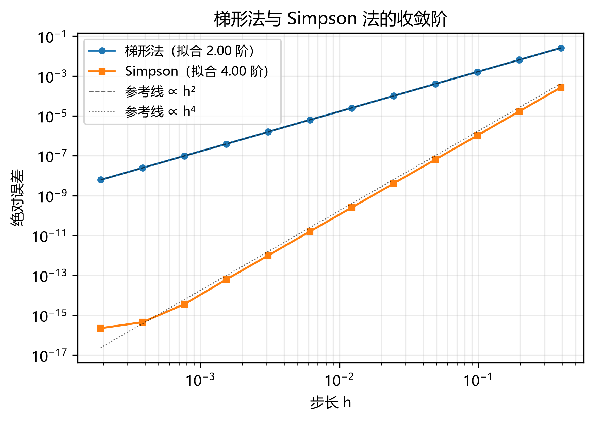

# num-methods

数值方法练习：用**收敛阶**验证自己写的算法是否正确。



> 一句话结论：梯形法实测收敛阶 2.00、Simpson 法 4.00，与理论值一致。

## 1. 问题

对同一积分，用不同精度的求积公式计算，观察误差随步长的变化。
目的不是"算出一个数"，而是验证**自己写的算法确实具有理论上的收敛阶**。

## 2. 物理/数学模型

$$\int_0^{\pi} \sin x \,\mathrm{d}x = 2$$

被积函数光滑、解析值已知，适合作为验证算法的基准。

## 3. 数值方法

- 梯形法：局部误差 O(h³)，全局 O(h²)
- Simpson 法：局部误差 O(h⁵)，全局 O(h⁴)
- 步长取 h, h/2, h/4, …，每组算一次误差

## 4. 结果

对 ∫₀^π sin x dx = 2：

| n | h | 梯形法误差 | Simpson 误差 |
|---|---|---|---|
| 8 | 3.93e-01 | 2.577e-02 | 2.692e-04 |
| 64 | 4.91e-02 | 4.016e-04 | 6.453e-08 |
| 512 | 6.14e-03 | 6.275e-06 | 1.575e-11 |
| 16384 | 1.92e-04 | 6.128e-09 | 2.220e-16 |

log-log 拟合得梯形法斜率 2.000、Simpson 4.003，对应二阶与四阶。
同一 n 下 Simpson 的误差比梯形法小 3–4 个数量级。

## 5. 验证

1. **解析解对比**：∫₀^π sin x dx 的解析值为 2，Simpson 在 n=512 时误差 1.6e-11。
2. **收敛阶**：log-log 拟合斜率 2.000 / 4.003，与理论 2 / 4 偏差 < 0.1%。
3. **解析性质单元测试**：梯形法对一次函数精确、Simpson 对三次多项式精确（误差 < 1e-12）。
4. **舍入地板**：n ≥ 2048 后 Simpson 误差停在 2.2e-16（机器精度），
   说明此时误差由浮点精度而非算法主导。

## 6. 复现与局限

```bash
python -m pip install -e ".[dev]"
python -m pytest
python scripts/run_all.py
```

**局限**：只测了光滑函数。对振荡或带奇点的被积函数，收敛阶会退化。
**下一步**：加入高斯-勒让德求积，对比"同样节点数下的精度"。
